# 🕵️‍♂️ Moreno Crime Network: Complex Network Analysis & Community Detection

[](https://www.python.org/)
[](https://networkx.org/)
[](https://jupyter.org/)
[](https://deepnote.com)
[]()

> **Workshop Team Management — Final Group Project**  
> An empirical investigation into criminal collaboration networks, structural role discovery, projection artifact disambiguation, and crime community detection using Network Science.
This project was developed as a collaborative effort during the Workshop Team Management course.

---

## 📌 Table of Contents

1. [Executive Summary](#-executive-summary)
2. [Research Questions](#-research-questions)
3. [Dataset Description & Preprocessing](#-dataset-description--preprocessing)
4. [Methodology & Analytical Pipeline](#-methodology--analytical-pipeline)
5. [People Projection: Centrality Analysis & Disambiguation](#-people-projection-centrality-analysis--disambiguation)
   - [Degree Centrality & Projection Artifacts](#1-degree-centrality--the-projection-artifact-paradox)
   - [Closeness Centrality & Information Proximity](#2-closeness-centrality--information-reach)
   - [Betweenness Centrality & Strategic Brokers](#3-betweenness-centrality--bottlenecks--brokers)
   - [Eigenvector Centrality & Gang Cliques](#4-eigenvector-centrality--cliques--gang-structures)
6. [Structural Roles in the Criminal Network](#-structural-roles-in-the-criminal-network)
7. [Crime Projection: Community Detection](#-crime-projection-community-detection)
   - [Louvain Modularity Optimization](#louvain-modularity-optimization)
   - [Infomap Flow-Based Clustering](#infomap-map-equation--flow-compression)
   - [Community Quality Comparison](#community-partition-quality)
   - [Induced Community Graphs](#induced-community-graphs)
8. [Workshop Team Management Reflection](#-workshop-team-management-reflection)
9. [Repository Structure](#-repository-structure)
10. [Installation & Getting Started](#-installation--getting-started)
11. [References & Data Attribution](#-references--data-attribution)

---

## 📖 Executive Summary

Criminal organizations and illicit collaborations are inherently relational. Law enforcement and investigative teams face critical questions:
- *Who are the true repeat offenders (recidivists) driving persistent criminal activity?*
- *Who operates as a broker or bridge between disparate gangs?*
- *Which suspects belong to tightly bound, cohesive criminal syndicates?*
- *How are crime events grouped into functional crime clusters?*

This project analyzes the **Moreno Crime Network** (KONECT), a bipartite network linking individuals (suspects, victims, witnesses) to criminal events. By filtering the network to suspect-only co-offending interactions and projecting it onto both the **people** and **crime** dimensions, we uncover criminal hierarchies, identify structural archetypes, and distinguish **true recidivists** from **bipartite projection artifacts**. Furthermore, we apply both modularity-based (**Louvain**) and flow-based (**Infomap**) community detection on the crime space to evaluate how criminal events cluster together.

---

## 🎯 Research Questions

1. **RQ1 (Structural Role Differentiation):**  
   *How can network centrality measures distinguish between distinct structural roles in a criminal organization (e.g., lone recidivists, gang leaders, and peripheral small-time offenders)?*
2. **RQ2 (Bipartite Projection Distortion):**  
   *One-mode projection of bipartite graphs commonly introduces structural artifacts (a single crime with many accomplices turns into a dense clique). How can we disentangle genuine persistent criminals from individuals inflated by large one-off crimes?*
3. **RQ3 (Crime Community Topology):**  
   *How is the criminal landscape organized on the crime-to-crime level, and how do modularity optimization (Louvain) versus flow-based information compression (Infomap) differ in segmenting criminal events?*

---

## 🗃️ Dataset Description & Preprocessing

The dataset originates from the **Moreno Crime Network** hosted on [KONECT](http://konect.cc/networks/moreno_crime). For convenience and immediate reproducibility, the complete original dataset is also bundled directly inside the [`data/`](./data) directory of this repository.

### Dataset Files in [`data/`](./data):
- **`out.moreno_crime_crime`**: The bipartite adjacency matrix in whitespace-separated format connecting Person IDs (left nodes) to Crime IDs (right nodes).
- **`rel.moreno_crime_crime.person.role`**: Role annotations for each interaction (`Suspect`, `Victim`, `Witness`, `Victim Suspect`).
- **`ent.moreno_crime_crime.person.sex`**: Demographic attribute (`sex`) for individuals in the network.
- **`ent.moreno_crime_crime.person.name`**: Entity identifier / pseudonym labels.
- **`meta.moreno_crime_crime`**: Metadata record from the original KONECT release.
- **`README.moreno_crime`**: Original dataset documentation.

### Preprocessing & Subgraph Filtering
To isolate criminal collaboration and co-offending dynamics:
1. Filtered all edges to retain only interactions where the role is `Suspect` or `Victim Suspect`.
2. Created a filtered bipartite subgraph: **490 nodes and 945 edges**.
3. Formed two distinct one-mode projections:
   - **People Projection ($G_{\text{people}}$):** Suspects are connected if they co-participated in at least one crime.
   - **Crime Projection ($B_{\text{crimes}}$):** Crimes are connected if they share at least one common suspect.

---

## 🔬 Methodology & Analytical Pipeline

```
       Raw Bipartite Data (1,380 nodes, 1,476 edges)
                           │
       Filter: role ∈ {'Suspect', 'Victim Suspect'}
                           │
      Bipartite Subgraph B_suspects (490 nodes, 945 edges)
             ┌─────────────┴─────────────┐
             ▼                           ▼
    People Projection           Crime Projection
     G_people_suspects               B_crimes
             │                           │
  Centrality & Disambiguation   Community Detection
  ───────────────────────────   ───────────────────
  • Degree Centrality           • Louvain Algorithm
  • Closeness Centrality        • Infomap Algorithm
  • Betweenness Centrality      • Partition Quality (Cov/Perf)
  • Eigenvector Centrality      • Induced Community Graphs
             │                           │
             └─────────────┬─────────────┘
                           ▼
           Synthesized Structural Insights &
               Law Enforcement Profiling
```

---

## 🔍 People Projection: Centrality Analysis & Disambiguation

A known challenge when studying projected bipartite networks is the **projection artifact**:
> An individual participating in a single crime with 20 accomplices suddenly connects to 20 other people, yielding an artificially elevated degree or closeness score, despite participating in only one crime.

To solve this, we formulated an **analytical disambiguation framework**, pairing each centrality metric with:
- **$N_{\text{crimes}}$:** Total number of distinct crimes committed by the individual.
- **$\text{Total Co-offenders}$:** Number of collaborators across all crimes.
- **$\text{Avg Co-offenders} = \frac{\text{Total Co-offenders}}{N_{\text{crimes}}}$:** Average co-offender group size per crime.

---

### 1. Degree Centrality & The Projection Artifact Paradox

$$\text{Degree Centrality}(v) = \frac{\deg(v)}{|V| - 1}$$

Degree centrality measures the normalized count of distinct co-offenders an individual has collaborated with.

<p align="center">
  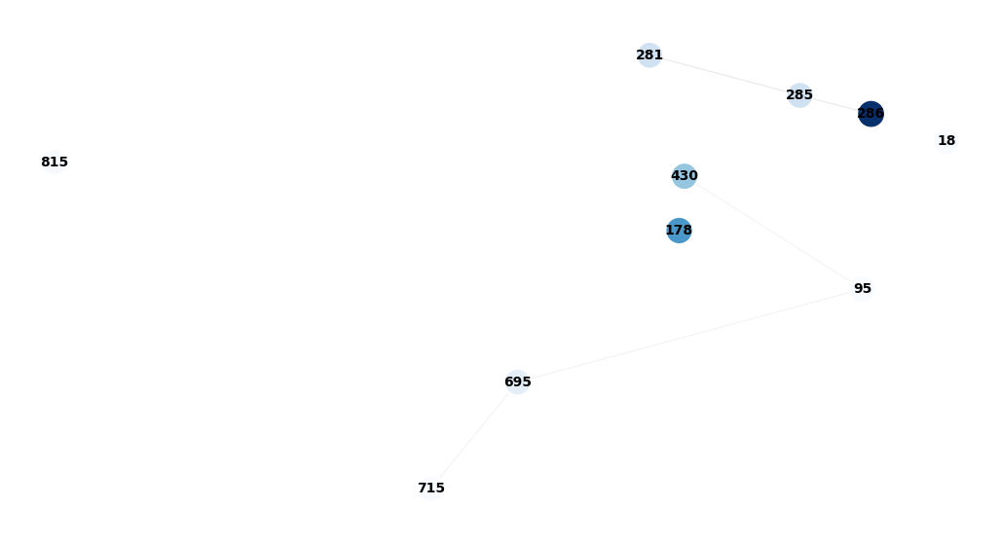
</p>

#### Top 10 Ranked Suspects by Degree Centrality:

| Rank | Person ID | Degree Centrality | Num Crimes | Total Co-offenders | Avg Co-offenders / Crime | Diagnostic Profile |
|:---:|:---:|:---:|:---:|:---:|:---:|:---|
| **1** | **815** | **0.0552** | **27** | **51** | **1.89** | 🚨 **True Serial Recidivist** |
| 2 | 285 | 0.0470 | 23 | 161 | 7.00 | 👥 Gang Member / Syndicate Figure |
| 3 | 178 | 0.0429 | 21 | 163 | 7.76 | 👥 Gang Member / Group Participant |
| 4 | 695 | 0.0389 | 19 | 138 | 7.26 | 👥 Active Serial Collaborator |
| 5 | 715 | 0.0389 | 19 | 62 | 3.26 | ⚠️ Consistent Small-Group Recidivist |
| 6 | 430 | 0.0368 | 18 | 126 | 7.00 | 👥 Group Crime Participant |
| 7 | 18 | 0.0348 | 17 | 53 | 3.12 | ⚠️ Focused Offender |
| 8 | 281 | 0.0348 | 17 | 139 | 8.18 | 👥 Large Gang Member |
| 9 | 286 | 0.0348 | 17 | 145 | 8.53 | 👥 Large Gang Member |
| 10 | 95 | 0.0348 | 17 | 179 | 10.53 | 🌐 Broad Network Broker |

**Key Insight:**  
Person **815** stands out decisively: with **27 distinct crimes** and an average of only **1.89 co-offenders**, this individual is an authentic serial recidivist operating in tight, small pairs. In contrast, suspects like **281** and **286** achieve their centrality through large group crimes ($\approx 8.5$ accomplices per event).

---

### 2. Closeness Centrality & Information Reach

$$C_{\text{close}}(v) = \frac{|V| - 1}{\sum_{u \neq v} d(v, u)}$$

Closeness measures how close a suspect is to all other suspects across shortest geodesic paths. High closeness suggests central positioning in the communication and informal information flow of the underworld.

<p align="center">
  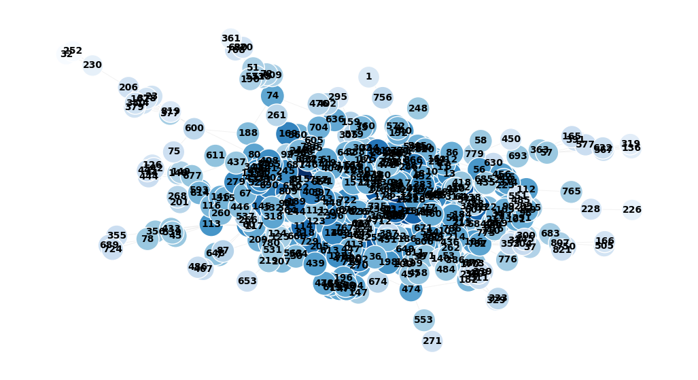
</p>

#### Top Suspects by Closeness Centrality:
- **Person 815** ranks **#1** ($C = 0.2336$), cementing their position not just locally, but globally within the network.
- **Person 695** ($C = 0.2324$) and **Person 43** ($C = 0.2286$) rank closely behind.
- *Caveat:* When large gangs collapse into cliques during projection, geodesic distances within the clique shrink to 1, which artificially pulls peripheral gang members toward higher closeness.

---

### 3. Betweenness Centrality: Bottlenecks & Brokers

$$C_{\text{between}}(v) = \sum_{s \neq v \neq t} \frac{\sigma_{st}(v)}{\sigma_{st}}$$

Betweenness identifies individuals who sit on the shortest paths connecting different groups, acting as **vital bridges, communication bottlenecks, or logistical brokers**.

<p align="center">
  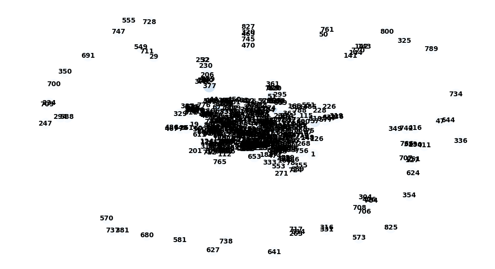
</p>

#### Top 5 Brokers by Betweenness Centrality:

| Person ID | Betweenness Centrality | Num Crimes | Total Co-offenders | Avg Co-offenders | Structural Role |
|:---:|:---:|:---:|:---:|:---:|:---|
| **815** | **0.1937** | **27** | **51** | **1.89** | 🌉 **Primary Network Hub / Bridge** |
| **95** | **0.1171** | **17** | **179** | **10.53** | 🤝 **Inter-Gang Coordinator / Broker** |
| 43 | 0.1075 | 8 | 115 | 14.38 | ⚠️ Cross-Clique Connection Point |
| 695 | 0.0980 | 19 | 138 | 7.26 | 🌉 High-Activity Multi-Group Offender |
| 425 | 0.0766 | 16 | 173 | 10.81 | 🌉 Co-Offender Cluster Connector |

**Key Insight:**  
- **Person 815** dominates betweenness ($0.1937$), confirming they link otherwise isolated cells together.
- **Person 95** displays a unique and critical profile: with **17 crimes** and **179 total co-offenders** ($10.53$ avg/crime), Person 95 acts as an indispensable link connecting different criminal crews. Eliminating or monitoring this node disrupts cross-gang communication.

---

### 4. Eigenvector Centrality: Cliques & Gang Structures

$$\lambda v_i = \sum_{j} A_{ij} v_j$$

Eigenvector centrality awards high scores to nodes that are connected to other highly connected nodes. In criminal network analysis, it highlights **cohesive cliques, criminal syndicates, and gang cores**.

<p align="center">
  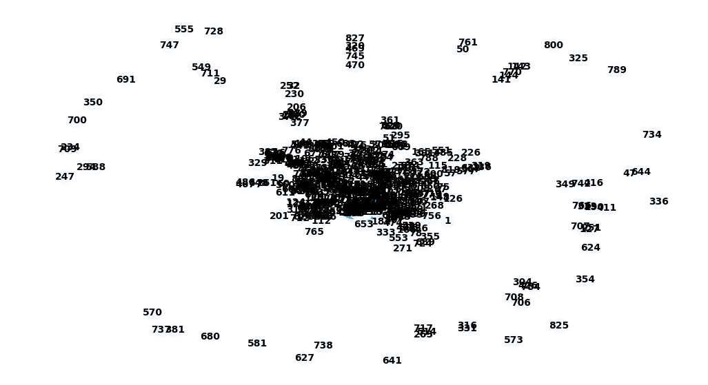
</p>

#### Top Suspects by Eigenvector Centrality:

| Person ID | Eigenvector Centrality | Num Crimes | Total Co-offenders | Avg Co-offenders | Syndicate Association |
|:---:|:---:|:---:|:---:|:---:|:---|
| **285** | **0.3321** | 23 | 161 | 7.00 | Gang Core / High Influence |
| **281** | **0.3026** | 17 | 139 | 8.18 | Gang Core / High Influence |
| **286** | **0.3015** | 17 | 145 | 8.53 | Gang Core / High Influence |
| **283** | **0.2989** | 16 | 137 | 8.56 | Gang Core / High Influence |
| **273** | **0.2935** | 14 | 135 | 9.64 | Gang Core / High Influence |
| **276** | **0.2935** | 14 | 135 | 9.64 | Gang Core / High Influence |
| **278** | **0.2021** | 10 | 146 | 14.60 | Gang Core / High Influence |
| **280** | **0.1779** | 9 | 108 | 12.00 | Gang Periphery / Group Actor |

**Key Insight:**  
Notice the clustering of IDs in the 270s and 280s. These suspects participate together in multi-person crimes with high average co-offenders ($7.0$ to $14.6$), revealing a **densely interconnected criminal syndicate / street gang**.

---

## 🎭 Structural Roles in the Criminal Network

Synthesizing all four centrality measures alongside co-offending frequency reveals distinct structural archetypes:

```
┌─────────────────────────────────────────────────────────────────────────────┐
│                            CRIMINAL ARCHETYPES                              │
├───────────────────────┬──────────────────────────────┬──────────────────────┤
│ Archetype             │ Identifying Metrics          │ Key Example(s)       │
├───────────────────────┼──────────────────────────────┼──────────────────────┤
│ 1. Serial Recidivist  │ High Degree, High Betweenness│ Node 815             │
│    (Lone / Pair Hub)  │ High Crimes (27), Low Avg (1.9)                     │
├───────────────────────┼──────────────────────────────┼──────────────────────┤
│ 2. Syndicate Broker   │ High Degree, High Betweenness│ Node 95              │
│    / Gang Coordinator │ High Crimes (17), High Avg (10.5)                   │
├───────────────────────┼──────────────────────────────┼──────────────────────┤
│ 3. Gang Core Member   │ High Eigenvector Centrality  │ Nodes 285, 281,      │
│    (Syndicate Clique) │ Moderate Crimes, High Avg    │ 286, 283, 273        │
├───────────────────────┼──────────────────────────────┼──────────────────────┤
│ 4. Projection         │ High Degree / Closeness,     │ Node 43, Node 278    │
│    Artifacts          │ Low Num Crimes (<3), Huge Avg│ (1-2 crimes,         │
│                       │                              │  inflated by clique) │
└───────────────────────┴──────────────────────────────┴──────────────────────┘
```

---

## 🏙️ Crime Projection: Community Detection

To examine how crime events are structured through shared suspects, we projected the bipartite graph onto the **crimes partition** ($B_{\text{crimes}}$: 539 crime nodes, 2,343 links). We compared two foundational community detection methodologies:

| Metric / Dimension | Louvain Algorithm | Infomap Algorithm |
|:---|:---:|:---:|
| **Algorithmic Basis** | Modularity Optimization ($Q$) | Flow Compression (Map Equation) |
| **Detected Communities** | **39** | **13** |
| **Minimum Community Size** | 1 | 2 |
| **Maximum Community Size** | 62 | 200 |
| **Mean Community Size** | 14.13 | 41.46 |
| **Median Community Size** | 6.0 | 8.0 |
| **Granularity** | Fine-grained, localized crime groups | Macro-scale operational basins |

---

### Louvain Modularity Optimization

Louvain maximizes modularity $Q$ through greedy local optimization followed by graph aggregation:

<p align="center">
  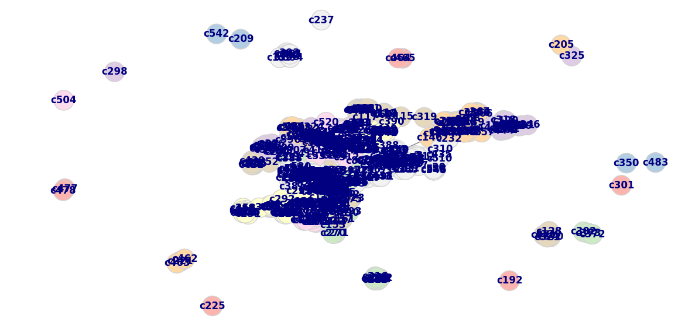
  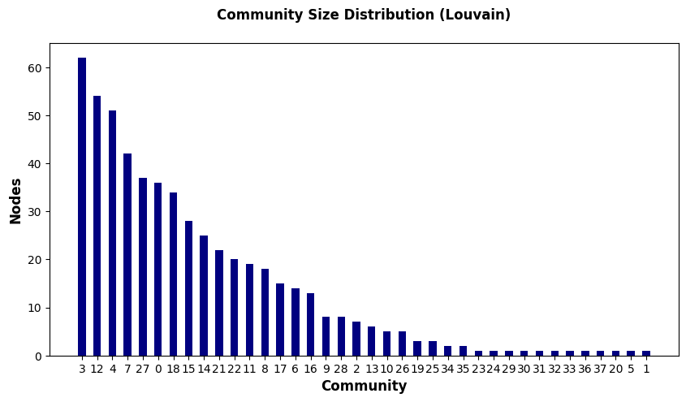
</p>

Louvain identifies **39 distinct crime clusters**, reflecting specific localized strings of offences linked by specific co-offending teams.

---

### Infomap (Map Equation & Flow Compression)

Infomap treats the network as a dynamic system, using a random walker to minimize description length (codelength):

$$\min_{\mathcal{M}} L(\mathcal{M}) = q_\curvearrowleft H(\mathcal{Q}) + \sum_{i=1}^{m} p_\circlearrowright^i H(\mathcal{P}^i)$$

- **Initial 1-level Codelength:** 8.598 bits
- **Optimized 2-level Codelength:** 4.988 bits (**~42% flow compression**)

<p align="center">
  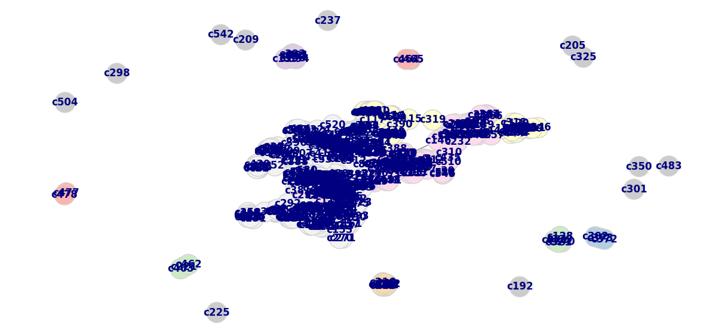
  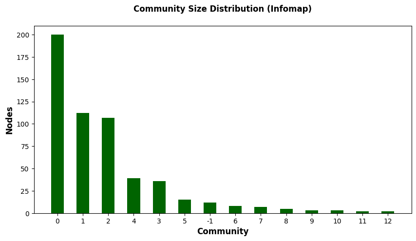
</p>

Infomap condenses the network into **13 broader communities**, highlighting widespread operational domains and shared recidivist patterns.

---

### Community Partition Quality

We benchmarked the quality of both partitions using **Coverage** and **Performance**:
- **Coverage:** Fraction of total edge weight that falls within community boundaries.
- **Performance:** Fraction of all pairs of nodes that are correctly classified (either connected and in the same community, or disconnected and in different communities).

<p align="center">
  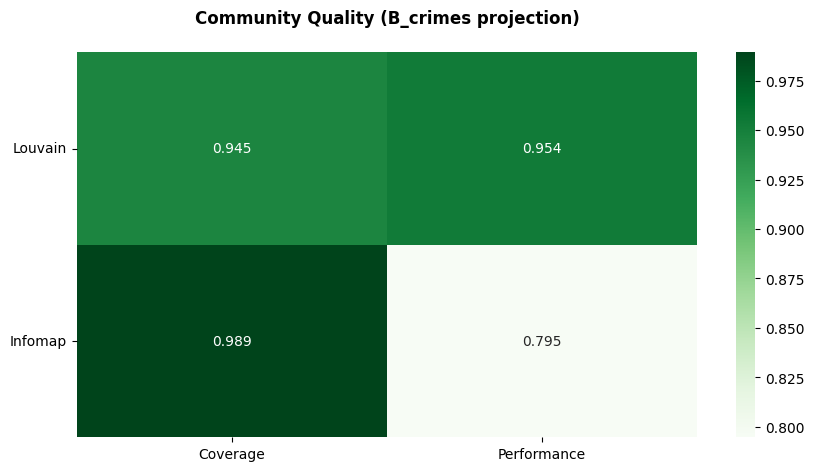
</p>

---

### Induced Community Graphs

To visualize the macro-structure of interactions between crime communities, we constructed **induced community graphs**, where each node represents an entire community and edge weights denote shared offender transitions:

<p align="center">
  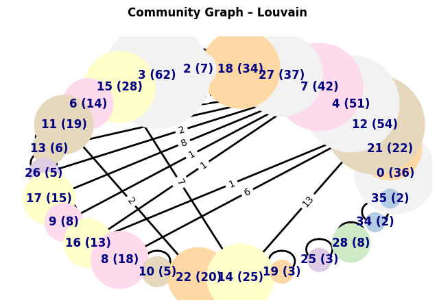
  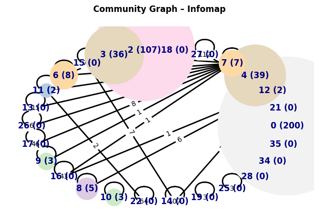
</p>

---

## 🤝 Workshop Team Management Reflection

As part of the **Workshop Team Management** course, this project served as a case study in collaborative data science and team execution:

1. **Strength-Based Task Allocation:**  
   Roles were assigned according to individual proficiencies (graph theory algorithms, visualization design, presentation scripting, and code architecture).
2. **Collaborative Tooling Stack:**  
   - **Deepnote:** Enabled real-time cloud collaboration on Jupyter notebooks, code reviews, and pair debugging.
   - **Google Slides & PowerPoint:** Facilitated simultaneous drafting of presentation deliverables.
   - **Communication Protocol:** Scheduled classroom brainstorming sessions supplemented by daily messaging check-ins to unblock technical hurdles promptly.
3. **Quality Assurance & Dry Runs:**  
   The team organized dedicated rehearsal sessions and mock presentations to refine narrative pacing, challenge each other's interpretations of projection artifacts, and align on conclusions.

---

## 📂 Repository Structure

```
├── Moreno Crime Network.ipynb       # Complete Jupyter notebook with code, plots & outputs
├── Moreno Crime Network.pdf         # Final presentation slides in PDF format
├── requirements.txt                 # Python dependencies
├── .gitignore                       # Git ignore rules
├── data/                            # Original Moreno Crime dataset files (self-contained)
│   ├── out.moreno_crime_crime       # Bipartite edge connections (Person -> Crime)
│   ├── rel.moreno_crime_crime.person.role # Role annotations (Suspect, Victim, Witness)
│   ├── ent.moreno_crime_crime.person.sex  # Person demographic attribute
│   ├── ent.moreno_crime_crime.person.name # Entity labels
│   ├── meta.moreno_crime_crime      # KONECT metadata
│   └── README.moreno_crime          # Original dataset documentation
├── assets/                          # High-resolution network visualizations & charts
│   ├── betweenness_centrality_network.png
│   ├── closeness_centrality_network.png
│   ├── community_quality_comparison.png
│   ├── degree_centrality_network.png
│   ├── eigenvector_centrality_network.png
│   ├── infomap_community_analysis.png
│   ├── infomap_community_sizes.png
│   ├── infomap_crimes_network.png
│   ├── infomap_induced_community_graph.png
│   ├── louvain_community_analysis.png
│   ├── louvain_community_sizes.png
│   ├── louvain_crimes_network.png
│   └── louvain_induced_community_graph.png
└── README.md                        # Project documentation (this file)
```

---

## 🚀 Installation & Getting Started

### Prerequisites
- Python 3.10 or higher
- `pip` package manager

### 1. Clone the Repository
```bash
git clone https://github.com/your-username/moreno-crime-network.git
cd moreno-crime-network
```

### 2. Set Up a Virtual Environment
```bash
# On Linux / macOS:
python3 -m venv venv
source venv/bin/activate

# On Windows (PowerShell):
python -m venv venv
.\venv\Scripts\Activate.ps1
```

### 3. Install Dependencies
```bash
pip install -r requirements.txt
```

### 4. Run the Jupyter Notebook
```bash
jupyter lab "Moreno Crime Network.ipynb"
```

> **Self-Contained Dataset:** All raw data files are pre-packaged in the `data/` folder, and the notebook automatically locates and parses them. Alternatively, the dataset can also be referenced directly from the official [KONECT repository](http://konect.cc/networks/moreno_crime).

---

## 📚 References & Data Attribution

1. **KONECT Moreno Crime Network:**  
   Opsahl, T. (2011). *Moreno crime network*. The Koblenz Network Collection. [http://konect.cc/networks/moreno_crime](http://konect.cc/networks/moreno_crime)
2. **Bipartite Projections in Criminology:**  
   Sarnecki, J. (2001). *A study of juvenile delinquency and co-offending networks*. Oxford University Press.
3. **Louvain Modularity Algorithm:**  
   Blondel, V. D., Guillaume, J.-L., Lambiotte, R., & Lefebvre, E. (2008). *Fast unfolding of communities in large networks*. J. Stat. Mech., P10008.
4. **Infomap & Map Equation:**  
   Rosvall, M., & Bergstrom, C. T. (2008). *Maps of random walks on complex networks reveal community structure*. PNAS, 105(4), 1118-1123.

---

<p align="center">
  <i>Developed with passion for Network Science & Collaborative Team Management.</i>
</p>
